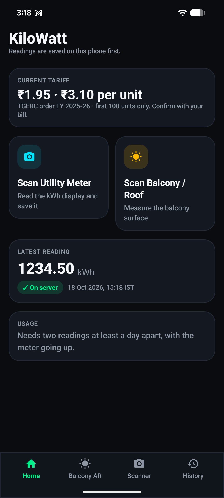
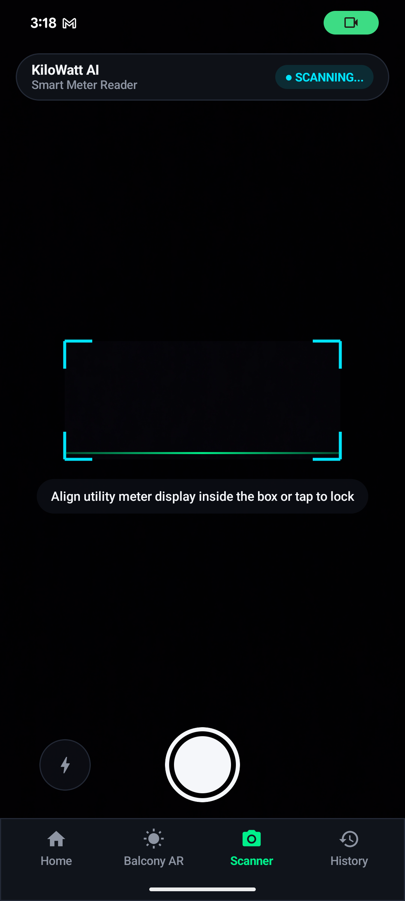
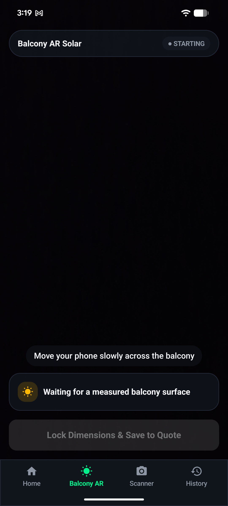
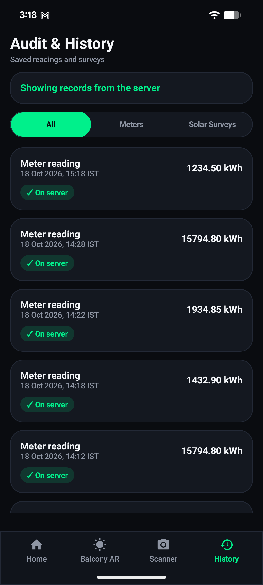

# KiloWatt India

An Android app for Indian households. It reads the kWh display of an electricity meter with the phone camera, saves the reading on the phone first, and uploads it to a server when the network is available. It also measures a balcony with ARCore and estimates rooftop or balcony solar output.

> Status: working prototype. The meter reader and the solar estimates still need testing on real meters before they can be relied on.

## Screenshots

| Home | Scanner | Balcony AR | History |
|---|---|---|---|
|  |  |  |  |

## What it does

- **Scan a meter.** The camera reads the kWh display with a TensorFlow Lite digit model. The reading is only saved after the user confirms it on the screen, by tapping **Yes, correct** or **Edit** and typing the value.
- **Save offline.** A confirmed reading is written to the phone's storage immediately. It is marked "Not on server yet" until the server accepts it.
- **Upload automatically.** When the phone is online, pending readings are sent to the ingestion server on launch and every 15 minutes. A reading is removed from the phone only after the server answers `201 Created`.
- **See what was saved.** History shows the server's records, marked "On server", and any phone-only records, marked "Not on server yet". Phone copies the server already has are never shown twice.
- **Measure a balcony.** ARCore detects the floor and draws its outline on the live camera. Span and area are shown only after the measurement has been steady for about two seconds. Panel count and yield are estimates.
- **Show the tariff.** The app uses the first two confirmed domestic slabs (₹1.95 and ₹3.10 per unit for the first 100 units). It does not guess higher slabs.

## Architecture

The app follows MVVM with a repository layer. See [ARCHITECTURE.md](ARCHITECTURE.md) for the full layout, data flow, and sync rules.

```
UI (Compose screens, ViewModels)  →  Repositories  →  Local store (phone) + Ingestion API (server)
                                  ↘  Domain rules (pure Kotlin, unit tested)
```

## Project layout

| Path | Purpose |
|---|---|
| `app/src/main/java/com/inouiw/kilowatt/domain` | Estimates, tariff, geometry, reading merge (pure Kotlin) |
| `app/src/main/java/com/inouiw/kilowatt/data` | Local JSON stores, HTTP client, repositories |
| `app/src/main/java/com/inouiw/kilowatt/sync` | WorkManager upload job and scheduler |
| `app/src/main/java/com/inouiw/kilowatt/ui` | Screens (stateless) and ViewModels |
| `app/src/main/java/com/inouiw/kilowatt/ml` | TensorFlow Lite meter reader |
| `app/src/main/java/com/inouiw/kilowatt/ar` | ARCore session factory and OpenGL renderer |
| `backend/` | FastAPI ingestion service (Python) |

## Build and run

Requirements: Android Studio, JDK 17, an Android 7.0+ phone with a camera. Balcony AR needs an ARCore-supported device.

```bash
./gradlew :app:installDebug      # install on a connected phone
./gradlew :app:testDebugUnitTest # run the domain unit tests (16 tests)
```

### Ingestion server

The server is only needed for uploads. Readings still save on the phone without it.

```bash
cd backend
python3 -m venv .venv
.venv/bin/pip install -r requirements.txt
.venv/bin/uvicorn main:app --host 0.0.0.0 --port 8000
```

- `POST /api/v1/readings` saves a reading and returns `201 Created`.
- `GET /api/v1/readings` returns the saved readings.
- `GET /health` checks that the server is running.

The phone must be on the same Wi-Fi network as the machine running the server. The address is set in `app/build.gradle.kts` as `INGESTION_BASE_URL`.

## Known limits

- **Meter reading accuracy is not measured.** The TensorFlow digit model has only been checked on a few photos. Readings must be confirmed by the user.
- **Only the first 100 units are priced.** The higher tariff slabs need the full table from the customer's bill.
- **Solar and yield figures are estimates.** Panel size, yield per kWp, and the offset calculation are assumptions to be checked against datasheets and local data.
- **Balcony surveys stay on the phone.** They are not uploaded yet.
- **The server has no authentication.** Add it before exposing the server beyond a trusted network.
- **16 KB page-size warning.** Debug builds show a warning about native libraries from TensorFlow Lite and ARCore. This must be fixed before publishing.
